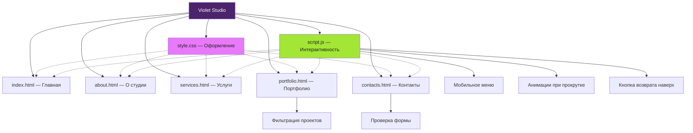

# Violet Studio — сайт креативной студии

## Описание

Violet Studio — многостраничный сайт креативной студии, которая предлагает услуги в области брендинга, веб-дизайна, разработки сайтов и создания цифрового контента.

Сайт предназначен для презентации студии, демонстрации её услуг и проектов, а также предоставления посетителям контактной информации для связи.

Проект разработан с использованием HTML5, CSS3 и JavaScript. Сайт имеет единый визуальный стиль, адаптивную вёрстку и интерактивные элементы интерфейса.
## Функциональность

- **Адаптивный дизайн** — корректное отображение на компьютерах, планшетах и смартфонах.
- **Навигация между страницами** — переходы между главной страницей, информацией о студии, услугами, портфолио и контактами.
- **Мобильное меню** — открытие и закрытие навигации на небольших экранах.
- **Презентация студии** — информация о Violet Studio и направлениях её деятельности.
- **Каталог услуг** — описание услуг по брендингу, веб-дизайну, разработке сайтов и созданию цифрового контента.
- **Портфолио проектов** — демонстрация примеров работ студии.
- **Фильтрация портфолио** — возможность сортировать проекты по категориям без перезагрузки страницы.
- **Анимация элементов** — появление блоков при прокрутке страницы.
- **Кнопка возврата наверх** — быстрый переход к началу страницы.
- **Форма обратной связи** — ввод имени, электронной почты и сообщения с проверкой заполненных данных.
- **Динамический год в подвале** — автоматическое обновление года в копирайте.

### Ограничения

Форма обратной связи пока проверяет введённые данные, но не отправляет сообщения на сервер. Для реальной отправки необходимо подключить серверную обработку или почтовый сервис. Данные портфолио и контактная информация используются как демонстрационное содержимое.
Violet-Studio/
├── index.html       # Главная страница
├── about.html       # О студии
├── services.html    # Услуги
├── portfolio.html   # Портфолио
├── contacts.html    # Контакты
├── style.css        # Стили и адаптивный дизайн
└── script.js        # Интерактивность сайта

5. Технический стек
Технология	Назначение
HTML5	Структура страниц
CSS3	Дизайн, сетки и адаптивность
JavaScript	Интерактивные функции
Git	Контроль версий
GitHub Pages	Размещение статического сайта
Результат: описание, функциональность и структура соответствуют проекту Violet Studio, а не исходному сайту из примера. При этом названия файлов и функции указаны по имеющейся версии проекта.